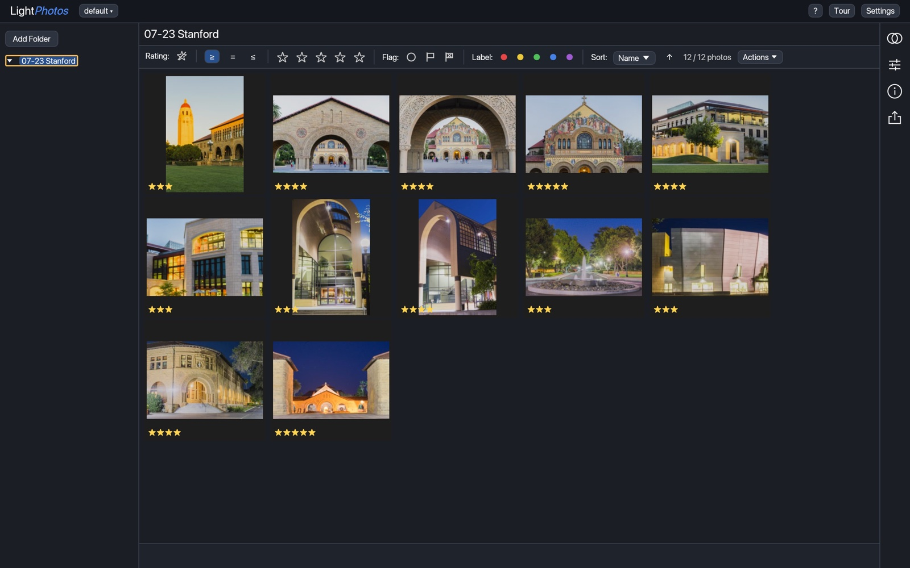
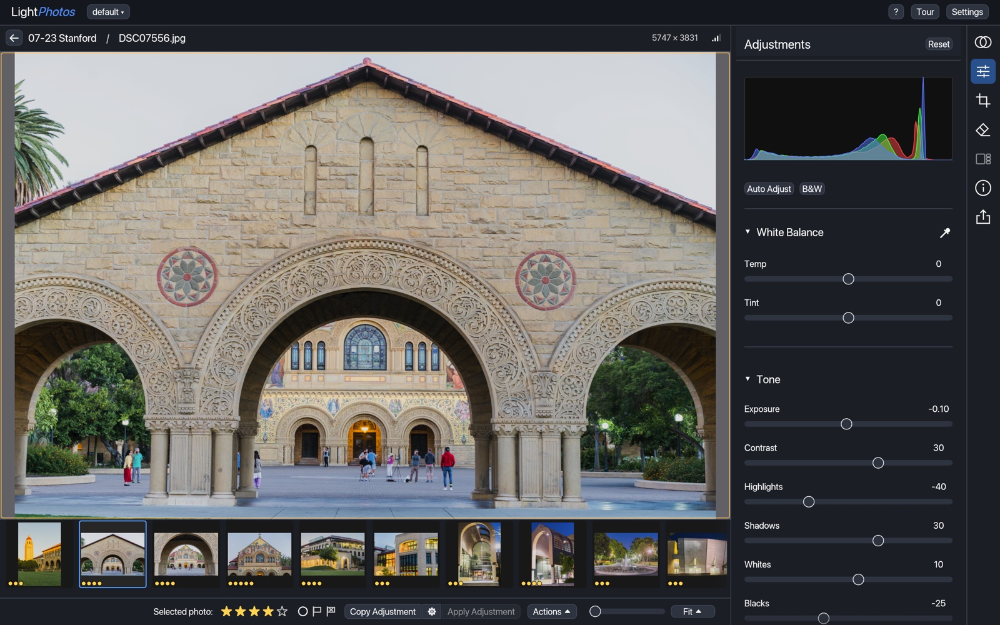

<!-- SPDX-License-Identifier: MIT OR Apache-2.0 -->

<h1></h1>

## What it does

LightPhotos is a fast, Lightroom-lite photo culling and develop tool written in
Rust. Open a folder to browse thumbnails in a Grid, rate and filter them, and
open any photo in the Loupe to zoom, pan and edit. JPEG, PNG, TIFF, HEIC and
camera RAW are supported. Ratings and edits are saved to a `.lightphotos` folder next to your photos, so
the originals are never modified.





It runs on macOS, Linux and Windows, and in the browser. Downloads and the
browser version are at **[lightphotos.app](https://lightphotos.app)**. HEIC and
the Vision-backed features (face/blink scoring) are
macOS-only.

Keyboard shortcuts are in [`docs/KEYBOARD_SHORTCUTS.md`](docs/KEYBOARD_SHORTCUTS.md)
(or press `?` in the app). The architecture diagrams are in
[`docs/SYSTEM_DIAGRAM.md`](docs/SYSTEM_DIAGRAM.md).

## How to build it from scratch

You need [Rust](https://rustup.rs). The repo picks the right toolchain for you.

### Desktop build

```sh
./scripts/setup.sh           # once per clone, and again when the rawler dependency changes
./scripts/build.sh release   # or: ./scripts/build.sh debug
./target/release/lightphotos /path/to/a/folder
```

The debug build works but decodes and renders much more slowly. On Windows, run
the scripts from Git Bash.

### Web build

Install [trunk](https://trunkrs.dev) once (`brew install trunk` or
`cargo install --locked trunk`), then:

```sh
./scripts/setup-web.sh    # once per clone, and again when the rawler dependency changes
./scripts/deploy-web.sh   # builds and copies the result into the lightphotos.app site repo
```

`deploy-web.sh` expects the site repo at `../lightphotos-app` (or set
`LIGHTPHOTOS_SITE_DIR`). It doesn't commit there, so review the diff and commit
it yourself.

### Profiling (optional)

`hotpath` instruments the paths a culling session waits on. Listing a folder gates the rest and always runs. Behind it sit the grid's screenful of thumbnails, the filmstrip's sliding window of them, the first pixels of a photo and the preview escalation that sharpens them, the full-resolution decode a zoom or a large window needs, an Auto Tone batch, a JPEG export batch, and the Vision signals. It is off unless a feature turns it on, and with its own features off its macros hand the function body back unchanged, so a default build carries no instrumentation.

```sh
cargo run --release --features hotpath -- --profile /path/to/a/folder        # timings
cargo run --release --features hotpath-alloc -- --profile /path/to/a/folder  # timings + bytes allocated per function
```

`--profile` drives the paths headlessly through the real `navigation`, `folder_store`, `Loader`, `thumbnail` and `export` code, prints a per-function report, and exits without opening a window. `src/shell/profile.rs` explains why the measurement does not go through the window.

`LIGHTPHOTOS_PROFILE_PHASES` narrows the run to a comma-separated list of phase keys, from `grid`, `strip`, `scroll`, `frame`, `open`, `full`, `auto_tone`, `export` and `vision`. Unset means all of them. An unrecognized key prints a warning naming the valid keys, and the run continues. `LIGHTPHOTOS_PROFILE_COLD=1` deletes the folder's cached thumbnails first, so the grid phase measures a first visit. `LIGHTPHOTOS_PROFILE_THUMBS`, `_OPENS`, `_PREVIEW_PX`, `_FULLS`, `_EXPORTS` and `_VISION` size the phases. The `vision` phase also times `score::score_photo` per photo, and `LIGHTPHOTOS_PROFILE_SCORE_DURING=1` runs a scoring job through the `scroll` phase so its fill time can be compared with and without one. `scroll` flicks a simulated grid viewport (`_SCROLL_ROWS` by `_SCROLL_COLS`, default 5 by 6) down the first `_THUMBS` photos one row per `_STEP_MS` (default 16) without waiting, and `strip` holds the arrow key the same way, so both report how long the last viewport takes to fill after the input stops; the report's `get_or_make` count is how many thumbnails the pool decoded on the way. The queue keeps up at 16 ms, so use `_STEP_MS=4` or `1` to see a backlog. The export phase writes every JPEG into a scratch directory under the system temp directory and removes it afterwards, so profiling a folder never leaves files in it. `frame` measures what a grid frame pays on the UI thread: baking edits into a viewport of thumbnails inline versus through the decode workers, and the signal cache's periodic write, which it runs against a scratch copy of the folder's file names. `LIGHTPHOTOS_CACHE_THUMBS`, `_PREVIEWS` and `_FULLS` override the loader's cache sizes (`src/jobs/cache_limits.rs`, one default per platform) for the app and the profiler alike.

hotpath's own `HOTPATH_*` variables still apply, so `HOTPATH_OUTPUT_FORMAT=json HOTPATH_OUTPUT_PATH=run.json` writes a report that a later run can be diffed against. The report prints the top 15 functions by total time. A full run instruments over 40, so raise `HOTPATH_FUNCTIONS_LIMIT` to see the cheap phases.

Turning `hotpath` on instruments the windowed app too. There the report prints when `main` returns, which Cmd+Q does not always reach, so set `HOTPATH_SHUTDOWN_MS=30000` to have it report on a timer instead.

### Live profiling (optional)

Only for profiling, not for normal builds. With a
[lightwatch](https://github.com/andrewyao/lightwatch) checkout at
`../lightwatch`:

```sh
./scripts/lightwatch-up.sh /path/to/a/folder   # starts an instrumented app and opens http://127.0.0.1:7700
./scripts/lightwatch-down.sh                   # stops everything lightwatch-up.sh started
```

The page shows function timings and live-object counts while you use the app.

Three processes run, because lightphotos emits only half the picture by itself. The daemon ingests and serves both the API and the UI; `lightwatch-hotpath` polls the app's hotpath server on `:6770` and re-emits function calls and timings; the app's own `lightwatch-probe` emits the live-object census that `#[lightwatch::track]` collects (`DecodedImage`, `Mask`). The daemon joins the two emitters into one session at `GET /api/sessions`. `LIGHTWATCH_REPO` points at the lightwatch checkout (default `../lightwatch`), `LIGHTWATCH_PORT` moves the UI, and pids and logs live under `$TMPDIR/lightphotos-lightwatch`.

### Control channel (optional)

`--control <port>` lets another program on the same computer drive the desktop app. The app listens on 127.0.0.1 only. `--control 0` picks a free port. At startup the app prints the port and an access token to stderr:

```sh
./target/release/lightphotos --control 0 /path/to/a/folder
# [control] listening on 127.0.0.1:52113 token 3f9c…
```

Set `LIGHTPHOTOS_CONTROL_TOKEN` (16 characters or more) to choose the token. The app then doesn't print it. Send one JSON object per line on a TCP connection. Each request gets one JSON line back.

A connection signs in first. The token never goes over the socket, and each side proves it holds the token before the other trusts it. Each proof is an HMAC-SHA256 keyed by the token, as lowercase hex.

1. Send `{"op": "hello", "nonce": "<64 random hex characters>"}`.
2. The reply holds the app's own `nonce` and a `proof`: the MAC of `lightphotos-control/server:<your nonce>:<app nonce>`. Check it. If it is wrong, the program on the port is not the app, or your token is wrong; send nothing more.
3. Send `{"op": "auth", "mac": …}` with the MAC of `lightphotos-control/client:<your nonce>:<app nonce>`.

```sh
mac() { printf 'lightphotos-control/%s:%s:%s' "$1" "$client_nonce" "$app_nonce" | openssl dgst -sha256 -hmac "$TOKEN" | awk '{print $NF}'; }
[ "$(mac server)" = "$proof" ] && mac client
```

```json
{"op": "hello", "nonce": "…"}
{"op": "auth", "mac": "…"}
{"op": "run", "command": {"id": "photo.rate", "params": {"stars": 3}}}
{"op": "commands"}
{"op": "state"}
{"op": "list"}
{"op": "wait", "timeout_ms": 10000}
{"op": "screenshot"}
```

Each `hello` answers one `auth`. A wrong `mac` gets `bad_token` and closes the connection. A request before the sign-in gets `auth_required`. A request that carries a `token`, as clients before the sign-in did, gets `raw_token_refused` with a message to update the client. A program that holds the port while the app is not running gets no MAC from a client, since it can't give the proof first, so it learns nothing to test token guesses against. Any local program can still connect to the app and get a proof for a nonce of its choice, so a guessable token can be found offline: keep the token the app makes, or set 32 or more random characters.

- `run` runs one command. `commands` lists every command id with an example, and every develop control with its range and current value.
- `state` returns the view, the selection, and the current photo's rating, flag and label.
- `list` returns each photo the Grid shows, in its order, with its rating, flag, label, quality score and whether it has edits: `{"photos", "total", "truncated"}`. It stops at 5000 photos.
- `wait` returns the state when decodes, sidecar writes, batches and animations are done, or a `timeout` error. The default is 10 s and the limit is 60 s.
- `screenshot` returns the window as a PNG: `{"png_base64", "width", "height"}`.

A reply is `{"ok": true, "result": …}` or `{"ok": false, "error": {"error": "<code>", …}, "message": "…"}`. The codes are the command errors and `bad_json`, `bad_token`, `auth_required`, `raw_token_refused`, `unknown_op`, `too_long`, `too_many_connections`, `idle_timeout`, `timeout`, `app_closed` and `failed`. A bad line gets an error and the connection stays open. A line over 1 MiB closes the connection. A connection that sends nothing for 60 s gets an `idle_timeout` error and closes. The app accepts 4 connections at a time. When the app closes a connection, open a new one to send more requests.

### Agent control (MCP)

`lightphotos-mcp` is an MCP server on stdio, so an agent such as Claude Code can cull, edit and look at photos. Build it with `cargo build --release --bin lightphotos-mcp`. Its tools are `list_commands`, `run_command`, `get_state`, `list_photos`, and `screenshot` or `render`. Call `list_commands` first: it gives every command id with an example of its params.

Headless, it works on one folder with no app open. Commands marked `headless` (rate, flag, label, rotate, develop, crop) write the photos' sidecars, and `render` returns a photo with its saved edits as a JPEG. Do not run it headless on a folder the app has open: the two overwrite each other's edits. Use `--attach` (below) instead, until the folder-lock work lands:

```sh
claude mcp add lightphotos -- /path/to/lightphotos-mcp --folder ~/Pictures/shoot
```

Attached, it drives a running app through the control channel, and `screenshot` returns the window. Start the app and the server with the same token; the server signs in with it, never sends it, and refuses a program on the port that can't prove it holds the same token. The app and the server must be the same version: an older server gets `raw_token_refused` from a newer app, and a newer server says the app is older. The token goes in `LIGHTPHOTOS_CONTROL_TOKEN`, not on the command line, where `ps` shows it to every user:

```sh
LIGHTPHOTOS_CONTROL_TOKEN=<32 hex characters> ./target/release/lightphotos --control 7777 ~/Pictures/shoot
claude mcp add lightphotos -e LIGHTPHOTOS_CONTROL_TOKEN=<the same token> -- /path/to/lightphotos-mcp --attach 7777
```

An agent works under tighter rules than the person at the keyboard. It is held to the folder the user has open. Every folder change that is not an agent's command sets that folder: the folder picker, the command line, Finder, the folder tree and the keyboard, a catalog, and the folder a launch reopens. An agent may `folder.open` that folder or a folder inside it, and may come back up to it, but never above it; a path through a link that points outside, or with `..`, is refused. When the user clicks into a subfolder, that subfolder becomes the folder the agent is held to: the rule is always "the folder you have open, and below". When the user opens a single photo (from Finder or the command line), the agent is held to that photo's folder alone, not the folders inside it. A launch puts back the folder the agent was held to when the app last quit, and only while it still holds the folder the launch reopens. A photo that is a link to a file outside that folder is out of the agent's reach, and a `screenshot` is refused while one shows. Its `export` lands inside that folder or in the export form's own folder (an Immich upload needs the form set to Immich), takes its album and copyright from the form, and keeps location and identifying camera data only when the form keeps them. An agent can't run `catalog.new`, `catalog.open`, `catalog.switch` or `preset.add_folder`: the user does those in the app. Photo and folder names reach the agent as text that anyone who can write a file name controls, so the tools tell the agent to treat them as data, never as instructions.

In the browser, the app registers `list_commands`, `run_command`, `get_state` and `list_photos` with WebMCP when the browser offers `document.modelContext` (or `navigator.modelContext`, as the `@mcp-b` polyfill does). An agent in the browser then drives the open app with the same requests as the control channel. There is no `screenshot` tool: the agent already sees the page. `run_command` carries `destructiveHint: true`, so a browser that asks before a tool changes things asks before each command. A browser without WebMCP logs one console line and the app runs as usual.

## Releasing and packaging

```sh
./scripts/release.sh
```

This runs the tests, tags `origin/main` with the next patch version (or the
one you pass, e.g. `./scripts/release.sh v0.2.0`), and pushes the tag. CI then
builds the macOS `.dmg`s, Linux tarballs and Windows zip and publishes the
GitHub Release. The checkout must be clean and at `origin/main`.

---

Dual-licensed under either [MIT](LICENSE-MIT) or [Apache 2.0](LICENSE-APACHE),
at your option.

The Linux, Windows and web builds also include a modified copy of
[rawler](https://crates.io/crates/rawler) for camera RAW decoding. rawler and
the patches to it in `patches/` are licensed under the
[GNU LGPL v2.1](patches/LICENSE-LGPL). The macOS build does not include it.
