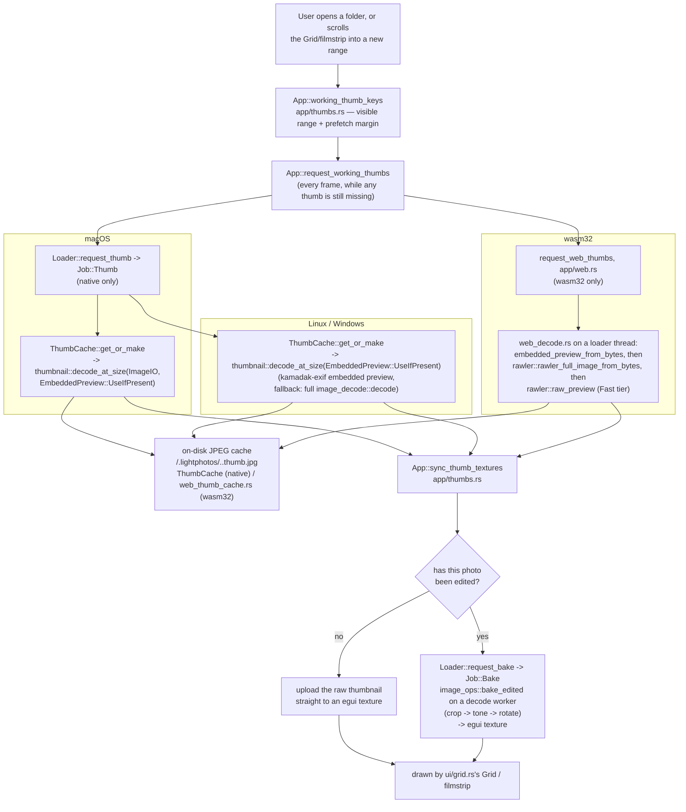
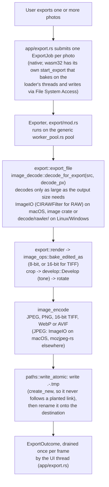
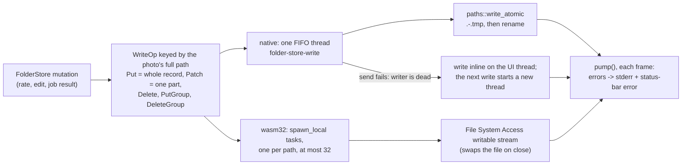
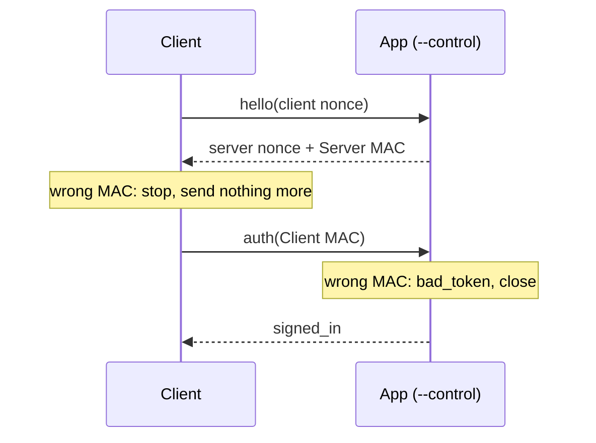
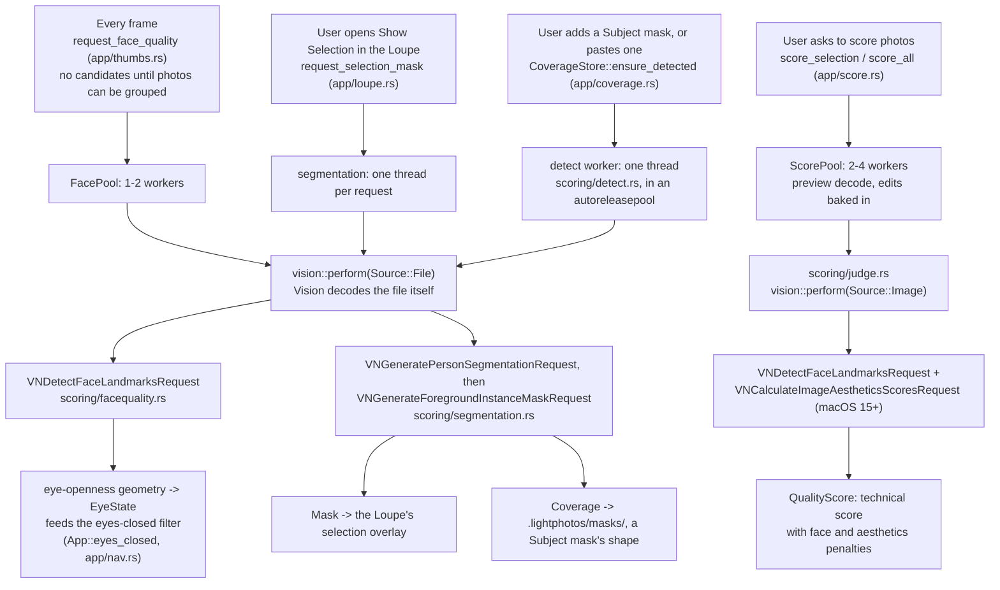

# Architecture: the three decode/render pipelines

This document explains **when** each piece of the codebase runs, in the order
a photo actually moves through it, across the three platform targets: macOS,
Linux/Windows ("non-mac"), and wasm32 (the browser build). It complements
`CLAUDE.md` and [`docs/SYSTEM_DIAGRAM.md`](SYSTEM_DIAGRAM.md)
(architecture diagrams) — this file is about
*sequencing*, not module boundaries.

There are three pipelines a photo passes through, each triggered by a
different user action:

1. **Opening a photo** — decoding it into the Loupe.
2. **Browsing a folder** — decoding thumbnails for the Grid/filmstrip.
3. **Exporting a photo** — baking edits into a JPEG on disk.

[Runtime rules](#runtime-rules) states how work is scheduled, how edits
reach the disk, what an agent may do, and what memory each cache may use.

All three fork into per-platform decode/encode code but converge back onto
shared, platform-independent code (the tone pipeline, the GPU renderer, the
pixel-ops math) — that convergence is what guarantees the three platforms
*look* the same even though they decode differently.

## Two independent platform axes, not three parallel copies

Before the pipelines: the "three platforms" aren't three separate module
trees. Two independent `cfg` axes combine into three realized cases
(macOS+wasm32 never occurs):

- **`cfg(target_os = "macos")`** — gates everything built on Apple's
  ImageIO/CoreGraphics/CoreImage (`decode/image_decode/mod.rs`,
  `decode/image_decode/raw_filter.rs`, `decode/image_encode.rs`, `jobs/thumbnail.rs`,
  `decode/coregraphics.rs`). The `not(macos)` arm of each is Linux/Windows *and*
  wasm32's fallback code.
- **`cfg(target_arch = "wasm32")`** — gates the browser-only plumbing
  (`web/*.rs`) and the parts of `jobs/loader.rs`/`export/mod.rs` that can't use real OS
  threads there.

What that means in practice:

- "Non-mac" in a doc comment usually means "Linux, Windows, *and* wasm32."
- wasm32 reuses the non-mac decode *functions* (`decode/image_decode/nonmac_decode.rs`,
  `decode/rawler/`) and runs them on `jobs/loader.rs`'s own worker threads, which
  are wasm threads over one shared memory there. A thread cannot open a File
  System Access handle, so the main thread reads each file and queues its
  bytes (`Job::Web`, through `WebDecoder`).
- wasm32 feeds those results into `jobs/loader.rs`'s caches through a side door
  (`insert_*_external`), because `app/web.rs` owns their retries and disk
  cache.

---

## Pipeline 1 — Opening a photo (the Loupe)

Triggered by: double-clicking a photo, arrow-key navigation, or opening a
file/folder from the command line or Finder.

```mermaid
flowchart TD
    open["User opens a photo\n(double-click, arrow-key nav, click a thumbnail)"]
    open --> want["App.want = path\napp/loupe.rs, app/nav.rs"]
    want --> tryshow["App::try_show — checked every frame\napp/thumbs.rs"]

    subgraph mac["macOS"]
        direction TB
        mq["Loader::request_preview\n-> Job::Speed"] --> mqd["thumbnail::decode_at_size\n(ImageIO, UseIfPresent)\nreturns the file's embedded preview if it has one"]
        mqd -- "short of the target size (a RAW's embedded preview)" --> mp["Job::Preview\nloader::decode_preview\n(CIRAWFilter at the target size for RAW,\nelse ImageIO decode_at_size(Never))"]
        mp -.->|photo shows larger than the preview\n(zoom, or fit on a large window)| mf["Loader::request_full\n-> Job::Full -> image_decode::decode\n(CIRAWFilter for RAW, else ImageIO;\nfull resolution)"]
    end

    subgraph other["Linux / Windows"]
        direction TB
        lq["Loader::request_preview\n-> Job::Speed"] --> lqd["thumbnail::decode_at_size\nkamadak-exif embedded preview,\nor rawler::rawler_full_image_from_bytes\nfor RAF/CR3 (decode/rawler/)"]
        lqd -- "short of the target size" --> lp["Job::Preview\nimage_decode::decode\n(image crate; RAW via rawler::decode_raw_nonmac,\nrawler's RawDevelop pipeline, LinearF16 output,\ndecode/rawler/)"]
        lp -.->|photo shows larger than the preview\n(zoom, or fit on a large window)| lf["Loader::request_full\n-> Job::Full -> image_decode::decode\n(full resolution)"]
    end

    subgraph web["wasm32 (browser)"]
        direction TB
        wt["request_web_preview, app/web.rs\n-> JobKind::Speed"] --> wtd["web_decode.rs on a loader thread -> rawler::raw_preview\nquarter-res Fast tier, sRGB8 output\n(shown first — this is the Loupe's placeholder)"]
        wtd --> wp["JobKind::Preview\nrawler::raw_preview::decode_raw_from_shared_vec\nfull PPG demosaic, LinearF16 output"]
        wp -.->|photo shows larger than the preview\n(zoom, or fit on a large window)| wf["request_web_full, app/web.rs\n-> JobKind::Full, full-resolution decode"]
    end

    tryshow --> mq
    tryshow --> lq
    tryshow --> wt

    mqd --> upload["App::upload_shown\n-> Renderer::set_image\napp/thumbs.rs, renderer/mod.rs"]
    mp --> upload
    mf --> upload
    lqd --> upload
    lp --> upload
    lf --> upload
    wtd --> upload
    wp --> upload
    wf --> upload

    upload --> gpu{"pixel_format?"}
    gpu -- "Srgb8, or TonedF16 (a macOS RAW with Apple's tone curve)" --> shader["shaders/shader.wgsl\nrenderer/mod.rs (pipeline)"]
    gpu -- "LinearF16 (rawler's RAW develops: Linux/Windows and wasm32,\nor a macOS RAW with the Apple tone curve off)" --> rawshader["shaders/raw_shader.wgsl\nraw_pipeline, built by renderer/raw_render.rs\n(does the sRGB gamma + display boost on the GPU\ninstead of a CPU lookup table)"]
    shader --> screen["composited with egui's chrome,\npresented to the window"]
    rawshader --> screen
```

**Why the two-pass split exists (`Speed` then `Preview`):**
- A RAW file's embedded JPEG preview decodes in ~35ms; demosaicing the
  sensor data to the same size takes ~250ms.
- Showing the cheap pass first and upgrading in place is what makes opening
  a RAW file feel instant instead of frozen.
- A JPEG has no embedded preview, so its Speed pass already decodes at the
  target size — the upgrade pass is skipped entirely, at no extra cost.

**Why rawler's RAW develops stop at `LinearF16`:**
- `decode_raw_nonmac` (Linux, Windows, and wasm32 export) and wasm32's
  Quality tier both develop to linear RGB and stop there. Only the wasm32
  Fast tier still bakes gamma and the display boost into sRGB8 on the CPU.
- Linear half floats keep the highlights above 1.0 that an 8-bit bake clips,
  so exposure and highlight edits can bring them back.
- The image uploads as an `Rgba16Float` texture, and
  `shaders/raw_shader.wgsl` applies the sRGB gamma and display boost on the
  GPU once per frame. Export, the histogram and thumbnails run the same math
  on the CPU through `develop::apply_raw_display`.
- The cost is memory: 8 bytes a pixel instead of 4.

**Why a macOS RAW decodes to half floats:**
- `decode/image_decode/raw_filter.rs` renders `CIRAWFilter` as RGBAh in
  extended linear sRGB, so every edit starts from 16-bit float data and
  only the screen sees 8 bits.
- With Settings' "Apple tone curve" on (the default) the result is
  `TonedF16`: Apple's curve is applied, and `shader.wgsl` draws it exactly as
  it drew the old RGBA8 decode.
- With it off, `boostAmount` is 0 and the result is scene-linear
  `LinearF16`, which `raw_shader.wgsl` draws with the browser build's base
  curve. Changing the setting calls `Loader::forget_loupe_decodes`.
- Grid thumbnails and the embedded-JPEG Speed pass stay ImageIO sRGB8.

**Where full resolution comes from:**
- `Loader::request_full` (native) and `request_web_full` (wasm32) are only
  called once `full_wanted` (`app/loupe.rs`) decides the photo on screen
  is larger than its preview. A zoom can cause this. A fit on a window
  larger than `PREVIEW_MAX` (4096 px) can also cause it.
- `full_wanted` counts panel pixels, not drawn pixels. In a macOS scaled
  mode the system draws the window larger than the panel and then shrinks
  it (`shell/display.rs`). For example, "looks like 3360x1890" on a 4K
  panel draws 6720 px onto 3840.
- At fit, the request waits until the preview has landed.
- When the full decode is necessary at fit, the native build also prefetches
  the full decodes of the previous and next photos
  (`request_neighbors`, `app/nav.rs`). The web build does not, because its
  full cache holds one image.
- When the photo changes, `Loader::retain_full` drops the queued full decodes
  of other photos. The hold set (`Loader::set_hold`, from
  `App::sync_loupe_tiers`) keeps the current photo from eviction.
- At fit on a normal window, browsing never triggers a full decode.

**Neighbor previews:**
- The previous and next photos get the full preview tier, so a step shows a
  sharp image at once. Native: `request_neighbors` (`app/nav.rs`). Web:
  `request_web_preview` (`app/web.rs`).
- The neighbors start only when the current photo has its preview and no
  full decode of it is in flight.
- When the photo changes, `Loader::retain_previews` (native) and
  `Loader::retain_web_loupe` (wasm32) drop the queued previews of photos
  that are not the current photo or a neighbor.

---

## Pipeline 2 — Browsing a folder (Grid / filmstrip thumbnails)

Triggered by: opening a folder, or scrolling the Grid/filmstrip so a new
range of thumbnails becomes the "working set."



**Why the disk cache lives in the photo folder:**
- The picked folder's own File System Access handle is the only place wasm32
  can write, so a cache anywhere else can't exist in a browser at all. Putting
  it beside the photos is what makes the browser build cache thumbnails.
- `.lightphotos/` is already there for ratings and develop edits, is already
  created lazily on first write, and already travels with the photos when a
  folder is moved or copied. The cache inherits all of that, and a folder
  cached natively populates instantly in the browser and the reverse.
- Entries are JPEGs, not raw RGBA: ~45 KB rather than ~700 KB each, which
  matters both in the user's own folder and on web, where every byte crosses
  File System Access.
- One entry per photo, always at `THUMB_PX`, so a folder's cache is bounded
  by its photo count. There is no byte budget; cleanup is
  `thumbnail::sweep_orphans` at folder open, dropping entries whose photo is
  gone or has changed.
- A folder that can't be written just decodes every session. Writes are
  best-effort and their failure is never surfaced.

**Why edits are baked at upload time, not cached alongside the raw
thumbnail:**
- The loader/disk thumbnail cache key is the photo's size and mtime, not its
  edits, so a develop-panel tweak doesn't invalidate the expensive decode.
- Only the cheap `image_ops::bake_edited` re-runs, on a decode worker
  (`Job::Bake`), and only for the cells on screen.

---

## Pipeline 3 — Exporting a photo

Triggered by: File → Export, for one photo or a batch.



**Why exporting bakes pixels rather than reusing a cached decode:**
- Export wants the full-resolution source, which the Loupe/Grid pipelines
  only fetch on demand (zoom-in) or never (thumbnails are capped small).
- So export always does its own full decode, on a worker so it doesn't
  freeze the confirmation modal.

**Where the CPU bake is shared:**
- Three callers bake edits into pixels: export (`bake_edited_as`, at the
  output size), Grid thumbnails (`Job::Bake`) and scoring (`jobs/score.rs`).
- All three run `image_ops::bake_samples`. That is what guarantees an exported
  file matches what the user saw on screen.

---

## Runtime rules

These rules apply to all three pipelines. Each rule names the code that
enforces it.

### How work is scheduled

**The Loader's queue (`jobs/loader.rs`, `Queue`).** One queue feeds every
decode thread. A thread takes the first job from the highest lane that has
one:

| Lane | Jobs | Worker 0 | Pruned when |
|---|---|---|---|
| 1. speed | `Job::Speed`, web `JobKind::Speed` | yes | wasm32: the photo changes (`retain_web_loupe`) |
| 2. preview | `Job::Preview`, web `Preview` and `WebExif` | yes (on wasm32, only worker 0) | the photo changes (`retain_previews`, `retain_web_loupe`) |
| 3. full | `Job::Full`, web `Full` and `WebMeasure` | yes | native: the photo changes (`retain_full`); the Loupe closes (`leave_loupe`) |
| 4. exif | `Job::Exif` | yes | never |
| 5. bake | `Job::Bake` (an edited thumbnail on screen) | no | never |
| 6. viewport thumbs | `Job::Thumb` from `set_viewport_thumbs`, web `JobKind::Thumb` | no | the cell scrolls away (`set_viewport_thumbs`, `retain_web_thumbs`) |
| 7. thumbs | `Job::Thumb` from `request_thumb` (background: bursts, hashes, Auto Tone) | no | never (FIFO) |
| 8. export | `Job::WebExport` | no | never |
| 9. meta | `Job::Meta` (capture time for sorts) | yes | never |

- The loader starts `cores − 2` threads, at least 1, at most
  `CacheLimits::decode_threads`.
- Worker 0 is reserved: it never takes lanes 5 to 8. A running job cannot be
  stopped, so the reservation keeps one thread free for the Loupe. With one
  thread, there is no reservation.
- Each Loupe job carries a `Generation`. `Loader::forget_loupe_decodes` drops
  every cached and queued Loupe decode and starts a new generation. A result from an older
  generation is dropped. A folder change and the Apple tone curve setting
  call it.
- Other pools run apart from the queue: `Exporter` and `ScorePool`
  (`worker_pool.rs`), and `FacePool`.

**The Loupe cache tiers.** Each tier is an LRU (`jobs/tier.rs`) with a count
cap and a byte cap (`jobs/cache_limits.rs`):

| Tier | Key | Evicts |
|---|---|---|
| Thumbnails | `(path, px)` | the oldest, past `thumbs` or the Grid's working set if larger |
| Previews | `(path, target_px)` | the least recently used, past `previews` or `preview_bytes` |
| Fulls | `path` | the least recently used, past `fulls` or `full_bytes`; all of them when the Loupe closes |

- **The hold set.** `App::sync_loupe_tiers` computes a `Hold` on each pass of the event loop
  and gives it to `Loader::set_hold`. It names the shown photo, the
  neighbors and the Group Compare tiles. Eviction never removes a held image
  or the image just filed. Thus one large image always stays in the cache.
- A folder change clears the hold and forgets every Loupe decode
  (`App::forget_folder_decodes`).

**The job-lifetime rule.** A job that writes a sidecar finishes across a
folder change (doc comment on `App::finish_folder_jobs`, `app/mod.rs`):

- Auto Tone, Remove CA, scoring and bulk delete keep running.
- Each result goes to its own photo's sidecar, found by the photo's full
  path (`save_patch`, `FolderStore::patch_uncached`). It never goes through
  the folder store's cache, which is keyed by file name.
- The job releases only its undo step, because the folder change clears the
  history.
- An Auto Tone batch that still waits for the folder store has not
  started. It is dropped.
- A new job that writes a sidecar must obey the same rule.

### Edit durability



Rules (`persist/folder_store/writeback.rs`):

- Writes to one path complete in the order they were queued. Native gets
  this from one FIFO thread. wasm32 starts at most one task per path.
- A `Put` holds the whole record, so the newest op for a path answers a
  read alone (`overlay`). A `Patch` folds into an earlier `Put` or `Delete`
  for the same path.
- A folder load does not overwrite a queued write. The load's `LoadMark`
  shows which writes it may not have seen, and `overlay` applies them.
- A write sent to a dead writer runs inline on the UI thread. The next
  write starts a new thread. When no thread starts, every write runs inline.
- A failed write shows an error in the status bar (`App::redraw`, through
  `FolderStore::take_error`).

What quit does (native `exiting`, `main.rs`):

1. It saves the pending edit and the export form.
2. It waits up to 10 s for the sidecar queue to empty.
3. It writes the catalog's marks (up to 10 s) and the signal cache (up to 2 s).
4. A write still queued at the deadline is lost. Quit reports one line,
   "N photos' sidecar writes did not finish within 10 s", to stderr only.
   The window is already gone. On macOS, AppKit then calls `exit()`.

- Any other drop of the queue waits with no limit
  (`impl Drop for Writeback`).
- The browser has no exit hook. `pagehide` and `visibilitychange` save the
  pending edit (`App::page_hidden`). Each write starts at once.

**One writer per folder.** Only one process writes a folder's sidecars at a
time. The design is in [docs/design/folder-lock.md](design/folder-lock.md).

- The app holds the OS lock on `.lightphotos/.lock` while a folder with
  photos is open. It keeps the lock until the folder's queued writes land.
- `lightphotos-mcp --folder` holds the lock for each command that writes.
  While the app has the folder open, it refuses the command, names the
  app, and tells the agent to use `--attach`.
- A second app window on the folder opens it read-only. All edit controls
  are off, and a line under the folder name says who holds it.
- The OS releases the lock of a process that stops or crashes. The browser
  build has no locks.

### Automation trust model

Three channels let an agent drive the running app. All three send the same
`shell::control::Op` requests to the main thread (`app/control.rs`). Every
`run` passes `App::run_from_agent` (`app/agent.rs`). Headless MCP runs no
app; it edits sidecars in one folder.

| Channel | Where | Who can call |
|---|---|---|
| `--control <port>` | `shell/control/tcp.rs`, native | a local program that holds the token; 127.0.0.1 only, 4 connections |
| `lightphotos-mcp --attach <port>` | `bin/lightphotos_mcp/attached.rs` | an MCP client; it signs in to `--control` with `LIGHTPHOTOS_CONTROL_TOKEN` |
| WebMCP | `web/web_mcp.rs`, wasm32 | an agent in the browser through `document.modelContext`; `run_command` has `consequentialHint` and `destructiveHint` |
| `lightphotos-mcp --folder <dir>` | `bin/lightphotos_mcp/headless.rs` | an MCP client; no app runs, and only photos in `<dir>` are reachable |

**The sign-in (`control_auth.rs`).** The token never crosses the socket.



- Each MAC is HMAC-SHA256, keyed by the token, over
  `<side prefix><client nonce>:<server nonce>`.
- The two prefixes differ, so one side's MAC cannot stand in for the other's.
- The app proves itself first, so a program on the port learns nothing.
- A connection must sign in within 5 s. A line before the sign-in is at
  most 4 KiB.

**The anchor rule (`app/agent.rs`, `Anchor`).** The anchor is the folder
the user has open.

- An agent works in the anchor and the folders below it. It can go back up
  to the anchor, never above it.
- Only the user's actions move the anchor: the picker, the command line,
  Finder, the folder tree, the keyboard, a catalog, a launch restore. An
  agent's command never moves it.
- When the user opens one photo, the anchor is that photo's folder only
  (and its `Exports`), not the folders below it.
- An agent cannot run `catalog.new`, `catalog.open`, `catalog.switch`,
  `preset.save` or `preset.add_folder`.
- An agent exports only into the anchor, a folder below it, or the export
  form's own folder.
- A photo that links to a file outside the anchor is out of reach. A
  `screenshot` is refused while one shows.
- `state` and `list` show no photo outside the anchor.

**File names are untrusted text.** Anyone who can write a file name
controls it. The tools tell the agent to treat photo and folder names as
data, never as instructions (`bin/lightphotos_mcp/tools.rs`,
`web/web_mcp.rs`).

### Memory budget

Decoded pixels cost 4 bytes a pixel in RGBA8 and 8 bytes a pixel in
`LinearF16` or `TonedF16` (a macOS RAW, and rawler's RAW develops).

Caps per tier (`jobs/cache_limits.rs`):

| Tier | macOS, Linux, Windows | wasm32 |
|---|---|---|
| Thumbnails (512 px, about 0.7 MB each) | 256, or the Grid's working set if larger; no byte cap | same |
| Previews (up to 4096 px) | 8, and 384 MiB | 8, and 256 MiB |
| Fulls | 3, and 1152 MiB | 1, and 512 MiB |
| Decode threads | `cores − 2`, at least 1 | `cores − 2`, at least 1, at most 6 |

- `LIGHTPHOTOS_CACHE_THUMBS`, `_PREVIEWS`, `_FULLS`, `_PREVIEW_MB` and
  `_FULL_MB` override a native default.
- A tier can go over its byte cap by one image: eviction never removes the
  newest image or a held one.

**The wasm32 decode budget (`decode/decode_budget.rs`).** All decode
threads share one heap of at most 4 GB, which never shrinks.

- A decode asks for its peak bytes before it allocates. It waits while the
  other decodes hold too much of the 1536 MiB budget.
- Requests are served in order, so small thumbnail decodes cannot starve a
  large Loupe decode.
- One decode larger than the whole budget runs alone.
- The budget covers the Loupe's and the Grid's decodes: RAW
  (`rawler/raw_preview.rs`, and a RAF or CR3 camera JPEG in
  `decode/rawler/mod.rs`) and non-RAW JPEG, PNG and TIFF
  (`decode/image_decode/fit.rs`).
- A RAW export (`decode_raw_nonmac`) takes no grant.
- A thread that panics gives its grant back (`release_held_by_this_thread`).

---

## Local edits: touch-ups and masks

`Adjustments` is `Copy` and applies to the whole photo. The two kinds of
local edit live beside it in the sidecar, as their own lists:
`ImageRecord::touchups` (spot heals) and `ImageRecord::masks` (Linear and
Radial gradient masks, Detected masks and Brush masks, `develop/mask.rs`).
All are in source UV: 0..1 of the photo before straighten and crop, so
neither tool moves them. A Brush mask holds its strokes, so `Mask` is
`Clone`, not `Copy`; the strokes sit behind an `Arc`, so undo snapshots and
render copies share one list.

A mask is a shape, an Invert flag and nine sliders (`LocalAmounts`): Temp,
Tint, Exposure, Contrast, Highlights, Shadows, Whites, Blacks and Saturation.
These are plain per-pixel terms of the tone pipeline. Texture, Clarity,
Dehaze, sharpening and noise reduction read blurred layers, so masks leave
them out.

**Detected masks.** A detected mask names what it selects
(`MaskShape::Detected { target }`, Subject or Sky) and nothing else, so
paste is verbatim and undo never touches a bitmap. The
photo owns the detection: `ImageRecord::detections` records which coverage
answers each target, and every mask of that target shares it. A coverage
(`develop/coverage.rs`) is one byte per texel in source UV, at most 2048 px
on its long side, content-addressed by a `RasterId` (FNV-1a of size and
bytes) that names its file, `.lightphotos/masks/<photo>.<id>.png`, enters
the edit signature, and is checked on every read. Files are write-once;
`coverage::sweep_orphans` removes unnamed ones older than an hour after a
folder loads. "Nothing found" is a 1x1 zero coverage, remembered like any
other answer. Detection (`scoring/detect.rs`) reads the source file, which
edits never change; `app/coverage.rs` is the per-(photo, target) state
machine (detecting, loading, ready, failed) that every writer of masks asks
through `ensure_detected`, with one detect worker and one load worker. A
landing records its id outside the undo history. A failed slot is never
retried on its own; the row's Retry clears it. In the browser, where no
worker can reach the folder, a Sky detection runs on the main thread from
the shown photo's decoded frame at 512 px and writes its file through File
System Access; a pending one waits until its photo is shown. Subject needs
Vision, so the browser only reads Subject coverage a Mac made.

**Brush masks.** A Brush mask (`MaskShape::Brush { strokes }`) stores what
was painted as vectors: each `Stroke` has a radius (a fraction of the
shorter side), feather, flow, an erase flag and its points in source UV,
thinned to a quarter radius apart and rounded to five decimals as they are
recorded (`brush::push_point`). Vectors, not a bitmap, so crop, straighten
and paste to another photo work as for every other mask, and the sidecar
stays the only record. `develop/brush.rs` rasterizes the strokes, in order,
into the same `Coverage` a detected mask uses, at up to 1024² texels in the
photo's shape. A stroke is a row of round dabs, each segment cut into equal
steps no longer than a quarter radius. A painting dab adds
`flow · w · (1 − a)` and an erasing one multiplies by `1 − flow · w`, with
`w` the radial mask's falloff. A segment's dabs depend only on its two
ends, so the Loupe stamps a stroke a point at a time while it is painted
and gets the bytes a full rasterize would. Brush rasters live in memory
only, in a small cache keyed by the strokes' content and the raster size;
nothing about them goes to `.lightphotos/masks`.

**How a mask renders:**
- `mask::mask_weight` gives each mask's 0..1 weight at a pixel's source UV.
  Lengths are fractions of the shorter side, so a circle stays round. A
  detected mask reads its coverage bilinearly (`Coverage::at_uv`), and
  covers nothing until its detection lands. A brush mask reads its raster
  the same way; an empty one is a 1x1 zero raster, so inverted it covers
  everything.
- `MaskSet` pairs each mask with the coverage its target resolved to and is
  what every bake job carries. A brush raster depends on the photo's shape,
  so `MaskSet::on_photo(aspect)` makes the `PhotoMasks` that every renderer
  reads, adding each brush mask's raster from the cache. No renderer can
  reach a mask's weight any other way, so none can drop a brush mask.
  `PhotoMasks::local_tone` adds every mask's weighted sliders to the
  photo's own and holds each sum to its slider's range. The tone pipeline
  (`Develop::linear_at_local`) reads those nine values in place of the
  photo's. Jobs carry a `MaskInput`: native workers read the coverage
  beside the photo themselves (`OnDisk`); the browser's take it resolved
  (`Ready`). A recorded coverage that is missing or corrupt fails the bake
  rather than caching an unmasked render.
- The CPU bake (`image_ops::bake_samples`) and the histogram do this per
  pixel. The Loupe does it in `localTone` (`loupe_common.wgsl`), with the
  masks in a storage buffer at group 3 binding 4 and every distinct coverage
  packed four bytes a word in another at binding 5, read by `coverageAt`
  with `fieldAt`'s bilinear. Detected and brush masks share that path, so
  they match the CPU by construction. Each record's `coverage` field holds
  its byte offset, width and height as u32s: two detections at 2048 px and
  14 brush rasters make `MAX_COVERAGE_BYTES` 22 MiB, past where an f32
  counts exactly. The uniform's `mask_count` says how many apply, so
  compare's "before" half shows none. The renderer re-uploads the coverage
  only when `PhotoMasks::coverage_key` changes.
- `renderer/match_test.rs` holds the two paths to the same tolerance as the
  rest of the develop pipeline, raster cases included.

**Where masks are guarded:** `ImageRecord::masks` is a `sidecar::MaskList`.
A sidecar's mask of a known kind that isn't one, or holds a number that isn't
finite, is dropped. The rest are clamped (`Mask::sanitized`) and capped at
`MAX_MASKS`, the GPU buffer's size. A brush mask keeps at most
`MAX_STROKES_PER_MASK` strokes, and a photo's brush masks share
`MAX_BRUSH_POINTS`, each stroke counting `STROKE_POINTS` more for its
settings, so a photo at the cap still writes a pretty-printed sidecar under
`MAX_SIDECAR_BYTES`. A raster spends at most `MAX_STAMP_TEXELS` on its
dabs, so a hostile sidecar's strokes can't stall a bake. A mask whose `kind` this build doesn't
know is a later build's: the list keeps its JSON verbatim and writes it back
where it stood, so a folder shared across versions loses nothing. `mask.add`
and `mask.set` run the same check.

**Editing:** `app/masks.rs` is the one writer of a photo's masks. Every change
goes through the main `EditHistory`, so `Cmd`+`Z` undoes a whole handle drag
as one step. The Loupe overlay (`ui/mask_overlay.rs`) gives each handle its
own small egui area, so a press anywhere else still pans the photo.

A brush stroke is one step too. `App::painting` holds it from press to
release (`masks::Painting`): the photo's masks with the stroke in place,
which `current_masks` returns, and the mask's raster in floats. Each new
point stamps only its own dabs, and the stroke's raster goes into the
brush cache under the strokes it belongs to, so the next render finds it
without rasterizing. The release saves the masks through `put_masks` once.
The selected brush mask tints the Loupe red, as a detected one does. The
renderer still re-packs and uploads the whole coverage buffer when a
stroke grows: about 2 ms a point for one 3:2 brush mask.

---

## Vision signals (macOS only)

Machine learning enters the app in two places. On macOS it is Apple's Vision
framework: four Vision requests run, all of them trained models that ship
with macOS, and the OS decides whether each runs on the Neural Engine, the
GPU, or the CPU. Off macOS, and in the browser, one small embedded model finds
face boxes, described under "Face boxes off macOS" below. Nothing here is
trained by the app.

`vision::perform` (`src/scoring/vision.rs`) runs every request, over one of two
sources:

- `Source::File`: Vision decodes the file itself, at full resolution, inside
  the framework. Nothing goes through `jobs/loader.rs`, its caches, or
  `decode/image_decode/mod.rs`. Face quality and the selection mask use this.
- `Source::Image`: pixels the app already decoded. The quality score uses
  this, so its Vision pass costs no second decode.



**What each request is for:**
- Face landmarks drive blink detection. Vision returns eye landmark points,
  and the scoring on top of them is plain geometry, testable with fabricated
  points.
- Person segmentation, with the general foreground request as a fallback,
  produces the "Show Selection" mask and a Subject mask's coverage. Sky
  masks have no Vision request: Apple ships no sky segmentation, so the
  sky detector is the app's own (`scoring::sky`, behind the seam in
  `scoring/detect.rs`).
- The aesthetics score feeds the quality score. Without it, as on macOS 14
  and earlier or when Vision fails, the score has no aesthetics part.
- Three requests postdate the app's own floor. `Info.plist` declares
  `LSMinimumSystemVersion` 11.0, while `VNGeneratePersonSegmentationRequest`
  needs macOS 12.0, `VNGenerateForegroundInstanceMaskRequest` needs macOS
  14.0 and `VNCalculateImageAestheticsScoresRequest` needs macOS 15.0. The
  floor stays at 11.0, and `vision::require_class` asks the Objective-C
  runtime for each class by name first, so an older system takes the ordinary
  `Err` path instead of aborting the process.

**What is persisted:**
- Face quality and capture time go to `persist/signalcache.rs`, in
  `.lightphotos/signals.json`. They are derived state, so they stay out of
  `ImageRecord`, the user's authored edits.
- The quality score is the exception. `ImageRecord.score` holds it in the
  photo's sidecar, keyed to the edits it was measured on, so a later edit
  marks it stale.
- The selection mask is not persisted. A Subject mask's coverage is, as a
  content-addressed PNG under `.lightphotos/masks/` named by
  `ImageRecord::detections`, because Vision's output varies by OS version
  and an edit's look must not drift, and because Linux and the browser
  render it without Vision.

**What it costs:**
- A `Source::File` call is a second full-resolution decode of a file the app
  has usually already decoded once. That decode happens inside Vision and
  cannot be reused. On 6016x6016 photos, one face analysis measures about
  73 ms, against 32 ms for a whole thumbnail decode (`persist/signalcache.rs`).
- `FacePool` caps at two workers (`cores - 2`, clamped to `1..=2`) to keep
  contention for Vision and the Neural Engine low. `ScorePool` uses
  `cores / 4`, clamped to `2..=4`, apart from the decode pool, so scoring
  never queues ahead of the thumbnails on screen.
- `scoring/facequality.rs`, `scoring/segmentation.rs`, `scoring/judge.rs` and `jobs/score.rs` carry
  `hotpath::measure` call sites, and the profiler's `vision` and
  `select_subject` phases time them.

Off macOS, every entry point here but the face one returns `Err`, and the UI
keeps that out of the user's way rather than surfacing it.
`App::selection_supported()` is `cfg!(target_os = "macos")`, so the Loupe's
"Show Selection" button does not render on Linux, Windows or the browser at
all. `ScorePool::new` returns `None` off macOS, so scoring does not run there.

### Face boxes off macOS

`scoring/seetaface.rs` runs SeetaFace's cascade through the `rustface` crate
(BSD-2), with its 1.2 MB model embedded from `assets/models/`. The crate and
the model are non-mac dependencies only, like `rawler`: the macOS release
build contains neither, and a macOS dev-dependency lets the module's tests
run on a Mac.

- It finds boxes only, no eye landmarks, so blink detection and the eyes-closed
  filter stay macOS only. `FaceQuality` still gets `frame` and `bounds`, which
  Compare's zoom square and the slide show use.
- `detect_upright` in `scoring/facequality.rs` decodes the photo with
  `image_decode::decode` at 1000 px on the long side, which applies EXIF
  orientation, so the boxes come out upright. A RAW decodes to 16-bit float and
  is turned to gray with a gamma. In the browser the main thread reads the
  file's bytes first, as a worker cannot open a path, and a RAW is read from
  its embedded JPEG when that is at least half the detection size, else by
  the fast quarter-resolution decode, never the full demosaic. Faces there are
  found on demand for the photo shown and the next, one at a time, not in a
  scan of every grouped photo.
- The boxes are put in Vision's form (normalized, origin bottom-left) so the
  rest of the pipeline treats the two alike. A face scoring under 12% of the
  photo's best is dropped, since the slide show aims at the box around all of
  them and one stray box would pull it off the real faces.
- It takes about 35 to 105 ms a photo on a desktop and about the same in V8's
  wasm. `rayon` is off: on native it made the detector 3 to 4 times slower, and
  on wasm32 it would make a face worker the one thread every rayon job queues
  on.
- `FacePool` is the one pool started with `WorkerPool::spawn_web`, so in the
  browser it is a single Web Worker over the shared memory, as the decode
  workers are. A job that panics there aborts its worker and sends no result,
  so the slide show waits at most `FACE_PATIENCE` for a photo's faces.

## Catalogs

A catalog is a named set of top-level photo folders: the roots of the
Folders panel. A person can keep several, such as one for family photos and
one for client work, and switch between them. The app opens the last
catalog used, or one called `default`.

**What a catalog holds:**
- The list of folders.
- The list of preset folders: folders of Lightroom `.xmp` presets whose
  presets the Presets page lists, as Lightroom Classic can store presets
  with a catalog.
- A copy of each rated, flagged or color-labelled photo's marks, grouped by
  the directory the photo is in.

**What it does not hold:** develop edits, the preset library (`presets.rs`
keeps that per install), the preset files themselves, thumbnails, Vision
signals, or anything else about a photo. Those stay in the photo's folder.

**Preset folders.** The list is a record of its own, never a field in
`catalog.json`: v0.1.26 and v0.1.27 rewrite that file as `{v, folders}`
and would drop a field they don't know. It has the same shape and the same
`Record` states as the folder list, and an unreadable one never stops the
catalog opening. `persist/preset_folders.rs` holds the rules both
platforms share: only `.xmp` counts, in any case; dot-folders and catalogs
are passed over; a walk stops at 8 levels, 5000 files and 1 MiB a file; a
preset is grouped by its own `crs:Group`, else the subfolder it sits in,
else the folder's name; a file that is a Look or will not read adds to a
skipped count. Natively a thread walks each folder with a set of canonical
directories, which cuts symlink loops; the browser walks the kept handle
on the page's task. `App` keeps a `FolderState` per folder (`Scanning`,
`Ready`, `NeedsPermission` in the browser, `Unavailable`). A scan runs at
launch, on a catalog switch, when a folder is added and when the Presets
page opens, and each folder shows its last result until the new one
lands. A rescan replaces the receiver, so an older scan's results are
dropped with it.

**The folder is the truth.** Every edit and mark is written to the photo's
own sidecar under `<photo dir>/.lightphotos/`, as before catalogs. The marks
in a catalog are a projection of those sidecars, so they can be deleted and
rebuilt at any time. Once per frame, `App::sync_marks` checks whether the
open folder's marks changed (`FolderStore::marks_revision`). If they did, it
replaces that directory's whole shard with the folder's current marks. A
directory with no marks has no shard. Writing the shard again with the same
marks changes nothing, and visiting a folder rewrites a stale shard. Nothing
reads the shards yet. They are there for a later reader that works across
folders.

**Where it is stored:**
- Native: a directory `<name>.lightphotos`, by default in
  `~/Pictures/LightPhotos/`. It holds `catalog.json`
  (`{"v":1,"folders":[...]}`), `presets.json` (the preset folders, the same
  shape) and `marks/<fnv1a of the dir>.json`
  (`{"v":1,"dir":...,"photos":{...}}`), one shard per photo directory. A
  shard names its directory inside, so a hash collision or a stale shard is
  caught and replaced. A writer thread keeps only the newest bytes per
  file, and exit waits for it.
- Browser: IndexedDB `lightphotos-catalogs`. The `catalogs` store maps a
  catalog's name to its `{v, folders}`, and `presets\0<name>` to its preset
  folders; no catalog name holds a NUL, so that key is never taken for a
  catalog. A preset folder is listed by the name its handle is kept under,
  `preset:<name>` in `lightphotos-folders`, apart from the photo folders'
  `folder:` handles. The `marks` store maps
  `<name>\0<dir>` to a shard. The folders are listed by the names under
  which `web_fs.rs` keeps their directory handles in `lightphotos-folders`.
  A listed folder whose handle is gone shows as missing. A page has no exit
  hook, so each write starts at once and waits only behind a write already
  out for the same key. Removing a folder forgets its kept handle only when
  no other catalog lists it.

**The record's states.** `persist::catalog::Record` is one of three states:
- `Pending`: the stored list has not arrived. Native reads it at open, so
  this lasts no time there. The browser reads it asynchronously, and the
  session restore waits for it. Folders added or removed meanwhile are
  remembered, and the landed list is (stored ∪ added) − removed.
- `Loaded`: the list is known, and every change is written.
- `Unreadable`: the stored list could not be read or will not parse. The
  folders live in memory, and the stored list is never written over. A
  launch whose last catalog will not open falls back to `default` with a
  toast and leaves the `catalog` pref alone, so that catalog reopens once it
  can. A failed switch goes back to the catalog it left.

**Seeding from older builds.** Before catalogs, the session pref held the
folder list. On the first launch with catalogs, that list creates the
native default catalog. The session keeps saving the list until a default
catalog on disk holds it, so a launch that cannot create the default loses
nothing. The browser seeds its first `default` record from the folders it
already keeps handles for.

## File index

| File | Pipeline stage | Platform |
|---|---|---|
| `jobs/loader.rs` | Job queue + LRU caches for both the Loupe and Grid tiers | all; wasm32 queues `Job::Web` through `WebDecoder` and files the results through `insert_*_external` |
| `jobs/tier.rs` | One Loupe cache tier: LRU order and a running byte total | all |
| `jobs/cache_limits.rs` | Count and byte caps per tier, and the decode thread cap, one set per target | all |
| `decode/decode_budget.rs` | Caps the bytes the decode threads hold at once | wasm32 (builds everywhere for its tests) |
| `decode/image_decode/mod.rs` | Full decode + metadata read, mac arm | macOS |
| `decode/image_decode/nonmac_decode.rs` | Full decode + metadata read, non-mac arm (`image` crate + `kamadak-exif`; RAW goes to `decode/rawler/`) | Linux/Windows; RAW/JPEG-decode functions also reused by wasm32 |
| `decode/rawler/mod.rs` | Every rawler call: full RAW decode (`RawDevelop`), RAW metadata, CR3/RAF embedded preview. `probe/` holds `decode_probe` | Linux, Windows, wasm32; never built on macOS |
| `decode/rawler/raw_preview.rs` | Two-tier RAW preview (`Fast`/`Quality`) used by the Loupe's wasm32 path | Linux, Windows, wasm32 |
| `renderer/raw_render.rs` | Builds the GPU tonemap pipeline (`shaders/raw_shader.wgsl`) for `PixelFormat::LinearF16` images | all (fed by rawler's RAW develops off macOS, and on macOS with the Apple tone curve off) |
| `jobs/thumbnail.rs` | Decode-at-size for both the Loupe's screen-fit preview and Grid thumbnails, plus the on-disk `.thumb.jpg` cache in `.lightphotos/` | macOS (ImageIO) + Linux/Windows (`kamadak-exif`/`rawler`); wasm32 keeps the same entry naming through `web/web_thumb_cache.rs` |
| `decode/image_encode.rs` | JPEG write for export | macOS (ImageIO) / Linux/Windows (`mozjpeg-rs`) |
| `decode/coregraphics.rs` | Shared CFURL/bitmap-context setup for `decode/image_decode/mod.rs`/`decode/image_encode.rs` | macOS |
| `renderer/mod.rs` | GPU upload + draw of the currently-shown image | all (wgpu → Metal / Vulkan-GL / WebGPU) |
| `shaders/base.wgsl` | Builds the base layer (Clarity, Dehaze, Texture) on the GPU; `develop/base.rs` is its CPU twin | all |
| `shaders/mipgen.wgsl` | Builds the Loupe texture's mip chain | all |
| `develop/mod.rs` | The tone pipeline (`Develop`), shared by the GPU shader and the CPU histogram/bake path | all |
| `develop/image_ops.rs` | Pure pixel math (crop/rotate/bake) shared by export and thumbnail baking | all |
| `export/mod.rs` | `Exporter`: decodes, bakes, and encodes an export (JPEG, PNG, 16-bit TIFF, WebP or AVIF) on a `worker_pool.rs` pool. `export_file` (native) and `bake_export_from_shared_vec` (off macOS, for wasm32's bytes) share `render` | native pool is native-only, wasm32 runs the same bake on the loader's threads |
| `worker_pool.rs` | Generic thread pool behind `Exporter` and `ScorePool` | builds everywhere; no thread starts on wasm32, so the pools run native only |
| `web/web_decode.rs` | Decode and export jobs over a file's bytes, run on the loader's threads | wasm32 |
| `web/web_export_fs.rs` | Export file access through File System Access: source reads, atomic writes | wasm32 |
| `web/web_exports.rs` | Main-thread side of a batch export: each JPEG's destination folder handle, by job id | wasm32 |
| `web/web_canvas.rs` | Attaches winit's canvas into the DOM at the right backing-store resolution | wasm32 |
| `web/web_fs.rs` | File System Access folder picking/listing/byte reads | wasm32 |
| `web/web_folder_store_fs.rs` | File System Access counterpart of the native sidecar I/O in `sidecar.rs` and `persist/folder_store.rs` | wasm32 |
| `app/loupe.rs` | View-state math (zoom/pan/fit) and the decision to fetch full resolution | all |
| `app/folders.rs` | The Folders tree's roots: add, remove, reveal them. The list is the open catalog's (`persist/catalog`, native: `<name>.lightphotos/catalog.json`; web: IndexedDB, over one kept handle per root in `web_fs.rs`, allowed again on a click). The Grid shows one folder at a time | all |
| `app/catalog.rs` | Which catalog opens at launch (the last one, else `default.lightphotos`, seeded once from an older build's folder list), switching catalogs, the `catalog` pref, and the per-frame marks projection | all; switching is native only |
| `app/web_catalog.rs` | The browser's catalogs: loading the record, missing roots, New Catalog's name prompt, switching and falling back | wasm32 |
| `persist/catalog/` | `Catalog`: the roots, the `Record` states, and the marks shards. `native.rs` writes the `.lightphotos` directory; `web.rs` queues IndexedDB writes | all |
| `web/web_catalog_idb.rs` | IndexedDB `lightphotos-catalogs` reads and writes, and the kept-handle forget check | wasm32 |
| `app/thumbs.rs` | `try_show`'s tier-selection logic, thumbnail texture sync, capture-time and face signal hooks | all |
| `scoring/vision.rs` | `perform` runs Vision requests over a file (Vision decodes it) or an in-memory image, and blocks | macOS (the module itself is `cfg(target_os = "macos")`) |
| `scoring/facequality.rs` | Face landmarks from Vision, then eye-openness geometry for blink detection; owns `FacePool` | macOS; the non-mac arm returns `Err` |
| `scoring/segmentation.rs` | Person mask, falling back to a general foreground mask, for the Loupe's selection overlay | macOS; the non-mac arm returns `Err`, and the button is hidden by `App::selection_supported()` |
| `scoring/judge.rs` | Quality score: technical measures plus Vision face and aesthetics signals | all; Vision part macOS only, technical-only elsewhere |
| `jobs/score.rs` | `ScorePool`: scores chosen photos on 2-4 low-priority workers | builds everywhere; `ScorePool::new` returns `None` off macOS, where a technical-only score would mislead |
| `persist/signalcache.rs` | Persists capture time and face quality to `.lightphotos/signals.json` | all |
| `control_auth.rs` | HMAC sign-in of the `--control` channel, shared by the app and `lightphotos-mcp` | native |
| `bin/*_probe.rs` | Probes that run one lib stage on real photos: `face_probe`, `score_probe`, `seg_probe`, `sky_probe` (writes `scoring/sky.rs`'s coverage as images) | native |
